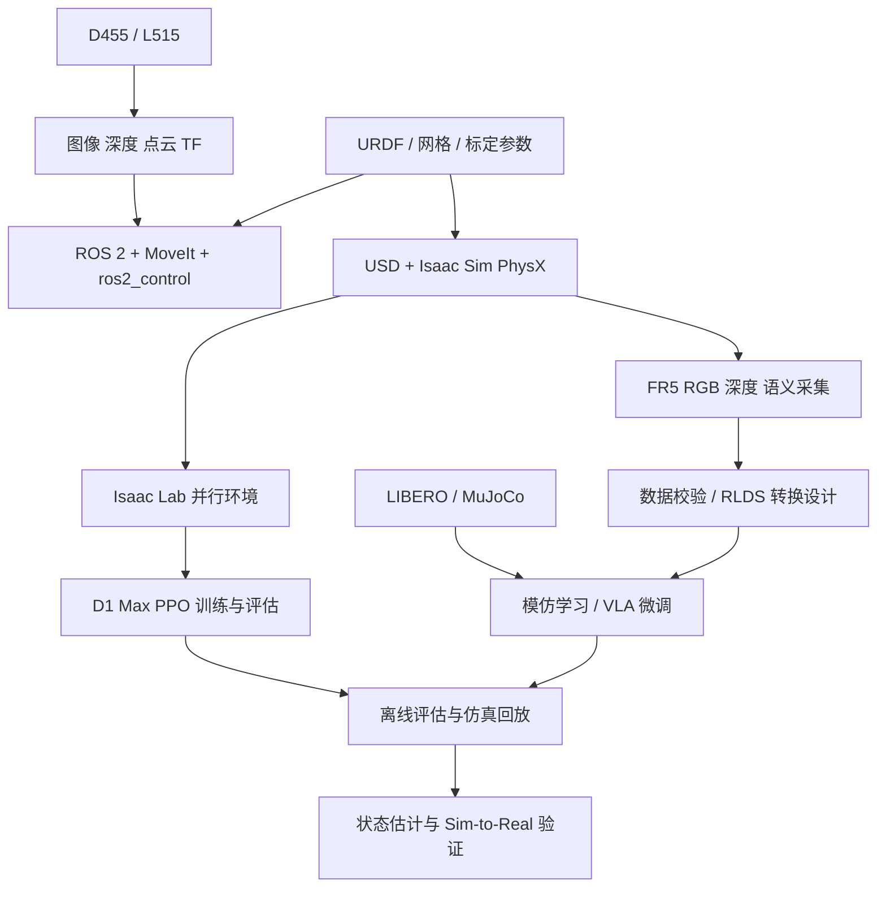

# 技术地图与部署状态

## 从任务理解技术栈

具身智能的核心是闭环：感知环境 → 估计状态 → 选择动作 → 控制执行 → 获得反馈。服务器上既有传统规划控制，也有数据驱动学习，两者共享模型、坐标、传感器和评估基础。



图中 RLDS 转换、VLA 与实机部署之间是**技术关系**，并不表示这些接口均已接通。

## 栈清单

| 层 | 已发现内容 | 证据与状态 | 文档 |
|---|---|---|---|
| 计算/隔离 | Ubuntu 22.04.5、4090、Docker、host 网络、VPN/noVNC | 当前核验 | [环境](01-infrastructure.md) |
| 仿真主线 | Isaac Sim 4.5、Isaac Lab 2.1.0、PhysX、Warp 兼容层 | 版本/目录当前核验；运动检查有历史报告 | [运行时](05-isaac-runtime.md) |
| 其他仿真环境 | Isaac Sim 5.1 标签镜像、NVIDIA Isaac Lab 2.1.0 镜像 | 镜像/停止容器存在，未启动验证 | [环境](01-infrastructure.md) |
| 机械臂模型 | FR5 v6＋90C、URDF/Xacro/SRDF、18 个迁移网格 | 历史工程与迁移目录存在 | [FR5](06-fairino-simulation.md) |
| 轮足模型 | D1 Max 原始 USD、URDF、训练覆盖层 | 原始 USD 为视觉资产，训练层来自 URDF | [模型](03-robot-assets.md) |
| ROS | Humble、Fairino 驱动/消息/描述/MoveIt 配置 | 当前源码盘点；没有正在运行的臂状态节点证据 | [ROS](04-ros2-moveit.md) |
| 相机 | D455、L515，realsense 工作区 | USB 当前可见；彩色话题只有订阅者 | [感知](07-perception-calibration.md) |
| 标定/服务 | handeye_ws、ext_config、camera_flask_server、Real_control | 工作区或 package.xml 存在，未验证标定质量/服务在线 | [感知](07-perception-calibration.md) |
| 抓取感知 | graspnet-baseline-main、depth-fm-main | 源码目录存在，未验证权重和推理 | [感知](07-perception-calibration.md) |
| 仿真数据 | RGB/深度/语义、NPZ 状态、episode 清单 | pilot/preflight/smoke 目录存在；采集器源码已读 | [数据](08-datasets-imitation.md) |
| 强化学习 | RSL-RL 2.3.1、PPO、TensorBoard、TorchScript | D1 有短测、续训及评估历史产物 | [D1](09-d1-max-rl.md) |
| VLA | openvla、openvla-oft-main | 源码目录存在；无本次端到端验证 | [VLA](10-vla-libero.md) |
| 基准/转换 | LIBERO、MuJoCo 学习工程、RLDS builder/mod | 源码目录存在，不能推断数据已转换或基准已通过 | [VLA](10-vla-libero.md) |
| 语言/空间辅助 | SpatialBot-main、GLM-4-main、LLM_prompt、翻译脚本 | 目录/文件名证据；具体接口未核验 | [VLA](10-vla-libero.md) |
| 实机连接 | Fairino Python SDK、ROS hardware、接收式 relay | 控制代码与只读路径均存在；文档将它们分开 | [同步](11-sim-to-real.md) |

## 目录定位

服务器宿主机：

```text
/data/dengming/
  isaaclab_fairino/
    apps/                       # 自定义 Kit experience
    assets/fairino5_v6_90c/      # Isaac 专用 URDF/网格
    ros2_source/                # 迁移保留的 ROS 描述与 MoveIt 配置
    usd/                        # FR5 转换资产
    scripts/                    # 采集、验证、只读同步
    vendor/                     # 局部 Warp 兼容包
    output/datasets/            # 抓取试采集
    robotdog_d1_max/
      source/ usd/ scripts/
      training/                 # PPO 任务与记录
  fairino/                      # SDK 目录；不用于仿真采集

/data/songjie/
  pkgs/config/                  # 基础 FR5 配置，不等于 90C 历史实验模型
  pkgs/frcobot_ros2-3.0.0_RobotV3.8.3/
  pkgs/frcobot_ros2-3.0.0_RobotV3.8.6/
  EMAI/                         # VLA、感知、RLDS、实机适配相关源码
  fr_ros2/                      # 自定义 ROS 实验工作区
  isaaclab_fairino/             # 另一份历史副本，不能与个人主线混用
```

ROS 容器内部还有 `/home/383_ws`、`/home/handeye_ws`、`/home/ros2_realsense_ws` 等目录，它们不都来自宿主机挂载。必须用 `docker inspect` 确认映射，不能仅凭同名目录推断同一份代码。

## 覆盖范围与不确定性

本手册覆盖具身智能相关已发现工作区、镜像和技术分支；不遍历其他成员的个人文档、凭据、私有数据或第三方依赖内部所有模块。目录存在只证明文件存在。网络在盘点中出现间歇性超时，未成功读取的内容保留“未核验”标签，见 [证据与缺口](16-evidence.md)。

未发现可证明已完成的 SLAM/Nav2、LeRobot、ACT 或 Diffusion Policy 部署，本手册将后者作为学习/扩展方向，不写成服务器现成能力。
